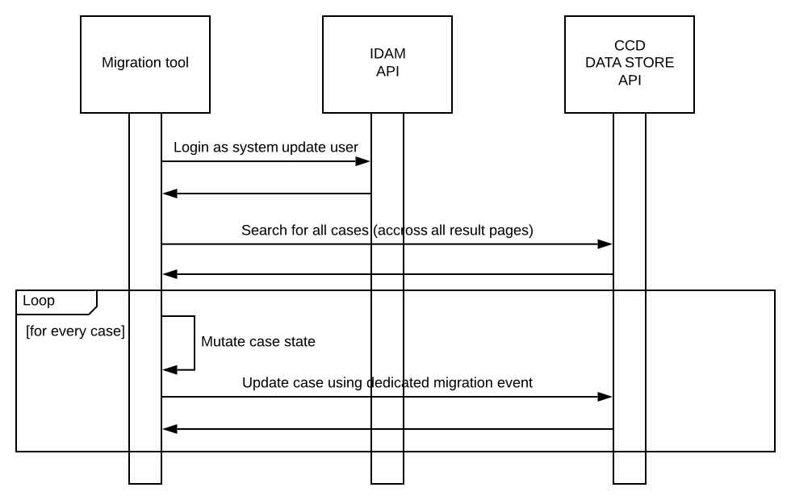

# ccd-case-migration-starter


CCD Case Migration Starter provides a framework for data migrations within CCD , to assist with case migrations that are required when the case definition changes in a way that requires existing cases to be updated to match the new case definition.

The framework runs the following process :-



The source code is maintained as a template within GitHub and is typically either cloned by a service team to establish a migration capability , or branched within the repository.

CCD Case Migration Starter framework source code is located in HMCTS GitHub repository  https://github.com/hmcts/ccd-case-migration-starter

It is built by Jenkins using HMCTS Jenkins job  https://build.platform.hmcts.net/job/HMCTS_a_to_c/job/ccd-case-migration-starter/

## Getting started

To utilise the CCD Case Migration Starter :-

1. Clone the GitHub repository and create a branch for the migration task.

2. Make the required source code changes for the migration task (see section below).

3. Create a pull request.

4. Request PlatOps to copy the JAR that was built using the pipeline from the repository to the bastion server for operation.

## Required source code changes

As a minimum , the source code changes described below should be made.

Create a Java class which implements `uk.gov.hmcts.reform.migration.service.DataMigrationService` interface in similar way as shown below :-

```java
package uk.gov.hmcts.reform.migration.service;

import org.springframework.stereotype.Component;
import uk.gov.hmcts.reform.ccd.client.model.CaseDetails;

import java.util.function.Predicate;

@Component
public class DataMigrationServiceImpl implements DataMigrationService {
    @Override
    public Predicate<CaseDetails> accepts() {
        return true; // Predicate that allows to narrow number of cases that gets migrated
    }

    @Override
    public void migrate(CaseDetails caseDetails) {
        // Case data migration logic goes here
    }
}
```

Ensure that the application properties below are configured as required in `application.properties` file :-

```properties
idam.api.url= # IDAM API URL used to authenticate system update user (pointing to localhost version of IDAM API by default)
idam.client.id= # IDAM OAuth2 client ID used to authenticate system update user
idam.client.secret= # IDAM OAuth2 client secret used to authenticate system update user
idam.client.redirect_uri= # IDAM OAuth2 redirect URL used to authenticate system update user

idam.s2s-auth.url= # S2S API URL used to authenticate service (pointing to localhost version of S2S API by default)
idam.s2s-auth.microservice= # S2S micro service name used to authenticate service
idam.s2s-auth.totp_secret= # S2S micro service secret used to authenticate service

core_case_data.api.url= # CCD data store API URL used to fetch / update case details (pointing to localhost version of CCD by default)

migration.idam.username= # IDAM username of a system update user that performs data migration
migration.idam.password= # IDAM password of a system update user that performs data migration
migration.jurisdiction= # CCD jurisdiction that data migration is run against
migration.casetype= # CCD case type that data migration is run against
migration.caseId= # optional CCD case ID in case only one case needs to be migrated

case-migration.elasticsearch.querySize= # Elasticsearch query size limit
case-migration.processing.limit= # Migration processing size limit
```

## Encoding a data string

Many migrations need an encoded data string passed to the migration service. Use the `MigrationDataEncoderApp` class to generate one:

1. Edit `testMigrationSourceFile.csv`:
- **Row 1:** the data name (header). Separate multiple names with commas.
- **Rows 2+:** the data to be encoded. Separate multiple values with commas. Each row will be encoded as a separate object in the resulting JSON array.
2. Run `MigrationDataEncoderApp`. The encoded string is written to a file in encodedStringOutput under the project root directory.

You'll use this string as a migration property (when running locally) or as a key vault secret (when running via cron job).

---

## Running locally against Preview, AAT or Demo

### 1. Set the service URLs

Set the following in `application.properties`, replacing `<env>` with `aat` or `demo`:

CCD_DATA_STORE_API_BASE_URL AS http://ccd-data-store-api-<env>.service.core-compute-<env>.internal
IDAM_OIDC_URL AS https://idam-web-public.<env>.platform.hmcts.net
IDAM_S2S_URL AS http://rpe-service-auth-provider-<env>.service.core-compute-<env>.internal
IDAM_API_URL AS https://idam-api.<env>.platform.hmcts.net
HMC_API_URL AS http://hmc-cft-hearing-service-<env>.service.core-compute-<env>.internal

**For Preview:** use `aat` as `<env>` for every URL except `CCD_DATA_STORE_API_BASE_URL`, which should point at your PR's preview data store:

CCD_DATA_STORE_API_BASE_URL AS https://ccd-data-store-api-sscs-tribunals-api-pr-<prNumber>.preview.platform.hmcts.net

### 2. Set the credentials

Get these from the key vault for the target environment and set them in `application.properties`

- `IDAM_SSCS_SYSTEMUPDATE_USER`
- `IDAM_SSCS_SYSTEMUPDATE_PASSWORD`
- `DATA_STORE_IDAM_KEY`
- `IDAM_USER`
- `IDAM_PASS`

> ⚠️ Don't commit these values to the repository.

### 3. Enable the migration

Set the properties in `application.properties` for the migration you want to run. For example, for `VenueMigrationService`:

```
VENUE_MIGRATION_ENABLED=true
VENUE_MIGRATION_DATA=<encoded data string>
```

### 4. Run

```bash
./gradlew bootRun
```

---

## Running as a cron job against AAT or Demo

All config changes in steps 2-4 below are made in the `cnp-flux-config` repository, under `apps/sscs/sscs-ccd-case-migration`.

1. **Store the encoded data (if your migration takes data).**
   Update the relevant azure key vault secret with the encoded data string.

2. **Update `<env>.yaml`** (e.g. `aat.yaml`, `demo.yaml`):

   a. Set the schedule in `spec.values.job.schedule`. This uses standard cron format.

```yaml
      schedule: "15 15 13 10 *"     # Once, at 15:15 on 13 October
      schedule: "*/15 15 13 10 *"   # Every 15 minutes between 15:00 and 15:59 on 13 October
```

b. If your migration takes data, add the key vault secret name and its alias (if not already present):

```yaml
      - name: encoded-string-ready-to-list
        alias: READY_TO_LIST_MIGRATION_ENCODED_STRING
```

c. Add the migration's enable flag (if not already present) and set it to `true`. After the migration is complete, you can remove it to keep the config clean.

```yaml
      READY_TO_LIST_MIGRATION_ENABLED: true
```

3. **Update `sscs-ccd-case-migration.yaml`** with the secret name and alias as in step 2b, if not already present.

4. **Update `00.yaml` or `01.yaml`** in the relevant environment folder, applying the same changes as steps 2.

---

## Running as a cron job against Prod

Follow steps 1–3 from [Running as a cron job against AAT or Demo](#running-as-a-cron-job-against-aat-or-demo), then check the following before scheduling:

- **Case limit:** a single migration run on Prod can process at most **1,200 cases**.
- **Caseloader:** make sure the migration isn't scheduled to overlap with the caseloader job.
- **Draft Archive Migrations:** If doing multiple runs of a migration in one night, consider setting `ARCHIVE_OLD_DRAFTS_ENABLED` to `false` for the duration, and re-enable it once all migrations have finished.

## Unit tests

To run all unit tests please execute following command :-

```bash
    ./gradlew test
```

## License

This project is licensed under the MIT License - see the [LICENSE](LICENSE) file for details.
